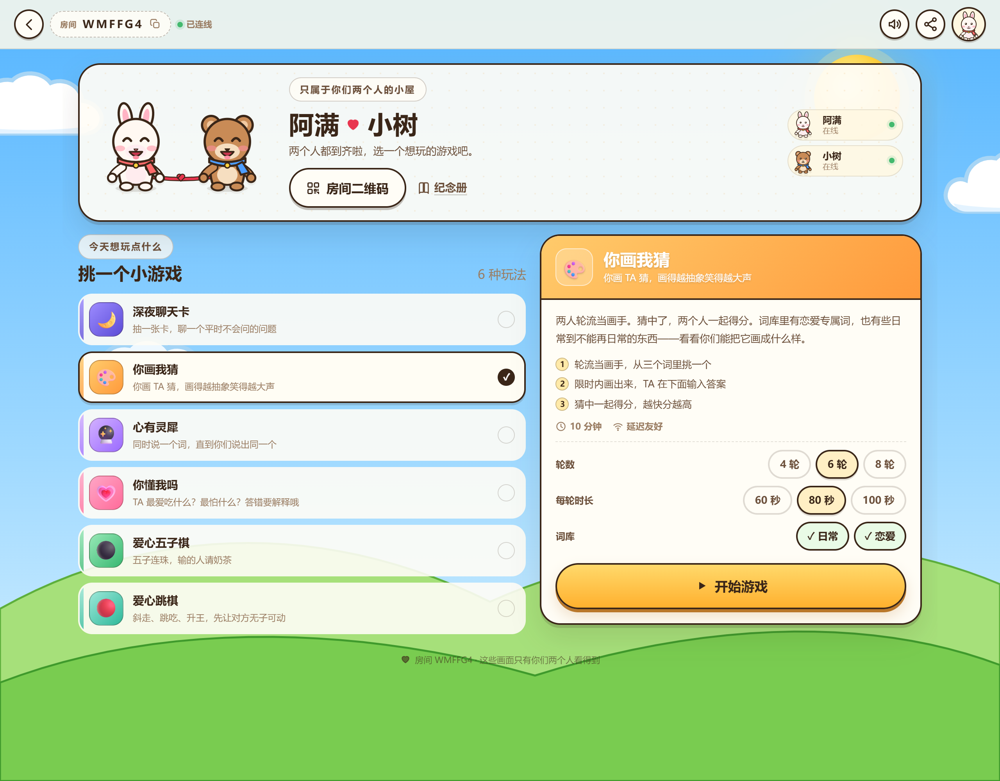
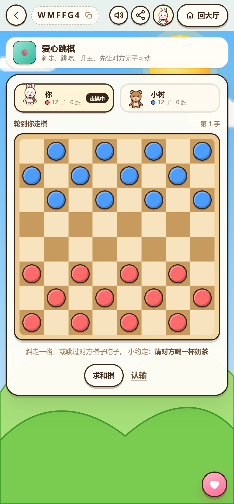

# 二人世界 · Duo World

[](https://github.com/colorful-lollipop/duo-world/actions/workflows/ci.yml)
[](LICENSE)
[](package.json)

给两个人做的在线小游戏小屋：创建房间 → 把链接发给 TA → 两台设备同时上线就能玩。
不用下载 App，不用注册账号；断线自动重连，每一局结束都会记进「我们的纪念册」。



## 现在能玩什么

| 游戏 | 玩法 | 适合 |
| --- | --- | --- |
| 🌙 深夜聊天卡 | 四套卡组轮流抽卡，认真回答对方的问题，喜欢的卡可以收藏 | 想好好聊天的时候 |
| 🎨 你画我猜 | 轮流当画手，实时同步画布，猜中两人一起得分 | 想笑出声的时候 |
| 🔮 心有灵犀 | 从两个词出发，同时写联想词，写出同一个就算成功 | 测试默契 |
| 💗 你懂我吗 | 轮流当主角回答关于自己的问题，另一半来猜，主角判分 | 想更了解彼此 |
| ⚫ 爱心五子棋 | 15×15 经典五子棋，带小赌约、悔棋请求、求和与认输 | 想分个胜负 |
| 🔴 爱心跳棋 | 8×8 西洋跳棋：斜走、跳吃、连跳、升王 | 想再分个胜负 |

所有玩法都是 **两人合作 / 对弈**，没有陌生人、没有排行榜、没有广告。



## 一个单屏、按需加载的游戏小屋

- **单页应用**：React + Vite，房间内路由切换不刷新页面。
- **单屏优先**：房间和游戏页固定在 `100dvh` 内，内部滚动但不显示页面滚动条；
  手机和桌面都适配（375×667 到 1440×900 已验证）。
- **按需加载**：大厅只加载游戏列表，点「开始游戏」后才下载那一款游戏的界面 chunk。
  新增游戏不会拖慢首屏。
- **服务端权威**：规则、计时、计分全部在服务端；客户端只发动作、只渲染快照。
  断线重连可以恢复整局进度。
- **两人一屋**：每个房间只有两个座位，靠 token 识别身份。

## 快速开始

要求：Node.js **20+**。

```bash
npm install
npm run serve        # 构建并启动，打开 http://localhost:8790
```

开发模式（前端热更新）：

```bash
npm run dev          # 前端 http://localhost:5173，后端 8790
```

### 两个人怎么一起玩

1. 一个人打开页面，填昵称、小动物和围巾颜色，创建小屋。
2. 点右上角分享，把**邀请链接**或**房间号**发给 TA。
3. TA 打开链接，填个昵称就坐到你旁边。
4. 各自拿一台设备，选游戏、调设置、开始。

同一 WiFi 下最方便：启动时终端会打印局域网地址（如 `http://192.168.1.8:8790`）。
如果宿主用 `localhost` 打开，分享弹窗会自动把链接换成局域网地址，手机扫码即可。
Windows 首次启动可能需要允许 Node.js 通过防火墙。

> 房间闲置 12 小时后自动清理；服务重启会清空所有房间（数据在内存里）。

## 部署

```bash
npm install
npm run build
PUBLIC_URL=https://duo.example.com PORT=8790 node server/index.mjs
```

`PUBLIC_URL` 用于生成分享链接和二维码；不设置时，本机 `localhost` 访问会自动探测局域网 IP。
建议套一层 Nginx 并启用 HTTPS，WebSocket 会自动从 `ws://` 切到 `wss://`：

```nginx
server {
  listen 443 ssl;
  server_name duo.example.com;

  location / {
    proxy_pass http://127.0.0.1:8790;
    proxy_http_version 1.1;
    proxy_set_header Upgrade $http_upgrade;
    proxy_set_header Connection "upgrade";
    proxy_set_header Host $host;
    proxy_set_header X-Forwarded-For $proxy_add_x_forwarded_for;
  }
}
```

### Docker

```bash
docker compose up -d --build
# http://服务器IP:8790
```

房间状态在 Node 进程内存里，请保持**单实例**运行；需要横向扩展时，
把 `server/rooms.mjs` 的房间存储换成 Redis / Postgres 共享即可。

## 项目结构

```
shared/games.json           # 游戏目录 + 设置表单（前后端共用）
server/
  index.mjs                 # Express + WebSocket + 静态文件
  rooms.mjs                 # 房间、座位、广播、结算、内存清理
  games/
    index.mjs               # 自动发现 server/games/*.mjs 并校验
    _kit.mjs                # 通用工具（随机、归一化、胜场统计）
    _template.mjs           # 服务端游戏模板
    <id>.mjs                # 每个游戏的规则，默认导出 create/action/tick/summary
  content/                  # 卡牌、词库、题库
src/
  pages/                    # 首页、房间页
  games/
    registry.ts             # 按需加载注册表（import.meta.glob）
    GameStageHost.tsx       # 游戏入口 + 统一结算页
    types.ts                # StageProps / ResultExtraProps 约定
    _template.tsx           # 界面模板
    <id>.tsx                # 每个游戏的界面，导出 Stage，可选 ResultExtra
  components/ lib/          # 小动物、场景、弹窗、WebSocket、音效
scripts/
  new-game.mjs              # 新游戏脚手架
  check-games.mjs           # 结构校验（build 前自动执行）
  smoke.mjs                 # 双客户端端到端测试
```

## 加一个新游戏

**不需要改任何中央注册文件。** 一条命令生成三件套：

```bash
npm run new:game -- red-rope 红绳 🔗 "#FF8A8A" "#E23E57"
```

生成：

```
shared/games.json          # 追加一条元数据（名称/介绍/规则/设置）
server/games/red-rope.mjs  # 服务端规则
src/games/red-rope.tsx     # 客户端界面
```

然后实现规则与界面，跑校验：

```bash
npm run check:games
npm run smoke
npm run build
```

### 服务端约定（`server/games/<id>.mjs`）

```js
export default {
  create(room) {
    // 返回可 JSON 序列化的 game.data
    return { phase: "playing", round: 0, rounds: 5 };
  },
  action(room, seat, action, now) {
    const d = room.game.data;
    if (action?.type === "tap") {
      d.round++;
      if (d.round >= d.rounds) d.phase = "over";
      return null; // null = 成功；字符串 = 给玩家看的错误
    }
    return "这个操作暂时不可以";
  },
  tick(room, now) {
    // 可选：每 400ms 调用一次，返回 true 会触发广播
    return false;
  },
  summary(room) {
    // 可选：data.phase === "over" 后写入纪念册
    return { title: "红绳", detail: "一起完成了…", data: {} };
  },
};
```

### 客户端约定（`src/games/<id>.tsx`）

```tsx
import type { StageProps } from "./types";

export function Stage({ room, seat, game, act, meta }: StageProps) {
  const d = game.data;
  return (
    <section className="stage">
      <h2>{meta.name}</h2>
      <button className="primary" onClick={() => act({ type: "tap" })}>
        点一下
      </button>
    </section>
  );
}

// 可选：结算页补充内容
export function ResultExtra({ game }: any) {
  return <p className="result-note">这一局拿到 {game.data.score} 分</p>;
}
```

- 文件名就是游戏 id，必须和 `shared/games.json` 一致。
- Vite 会自动把每个 `src/games/<id>.tsx` 拆成独立 chunk，开局才加载。
- `GameStageHost` 统一渲染结算页；界面不需要处理 `phase === "over"`。
- 设置项由 `shared/games.json` 的 schema 自动渲染；服务端会校验非法值并回退默认。

## 脚本

```bash
npm run dev         # 开发模式
npm run build       # 类型检查 + 游戏结构校验 + 生产构建
npm run start       # 运行生产构建
npm run serve       # build + start
npm run smoke       # 双客户端跑完所有游戏（含断线重连）
npm run check:games # 只做游戏三件套校验
npm run new:game    # 新游戏脚手架
```

`scripts/visual.mjs` 是可选的界面截图脚本（本机安装 Chrome + `playwright-core`）：

```bash
npm i -D playwright-core
node scripts/visual.mjs        # Chrome 不在默认路径时设置 CHROME_PATH
```

## 设计说明

- **服务端权威**：所有状态在服务端推进，客户端只发动作；服务端广播完整快照。
  两端不会因为延迟出现规则分歧，断线重连也能恢复。
- **房间两座**：token 存在各自浏览器 localStorage；同一 token 在别处打开会接管旧连接。
- **笔迹流**：画板坐标 1000×1000，每 45ms 批量发送；服务端保存并在新连接时重放。
  普通状态广播会剔除笔迹，避免每条消息都带整张画。
- **不存数据库**：房间在内存里，12 小时无人在线后回收。
- **纪念册**：每局结束服务端调用 `summary()`，写入 `room.journal`，大厅与结算页展示。

## 已知限制 / Roadmap

- 房间与纪念册在内存里，重启即消失；可接 SQLite 做长期保存。
- 还没有文字聊天和语音，只有表情反应。
- 你画我猜暂未保存画作原图，可扩展为画廊 / 笔迹回放。
- 可以继续加：合照拼图、红绳平台、节奏同步、飞行棋、谁是卧底、旅行地图……
- 音效由 WebAudio 实时合成，无额外音频资源。

## 贡献

欢迎 Issue / PR：

- 阅读 [CONTRIBUTING.md](CONTRIBUTING.md) 和 [CODE_OF_CONDUCT.md](CODE_OF_CONDUCT.md)
- 新游戏请使用 `npm run new:game`
- 提交前跑 `npm run build` 和 `npm run smoke`
- 安全问题请看 [SECURITY.md](SECURITY.md)

## License

[MIT](LICENSE) © 2026 duo-world contributors

玩法灵感来自常见的双人小游戏；本项目的代码、插画、文案与卡牌内容均为重新实现。
